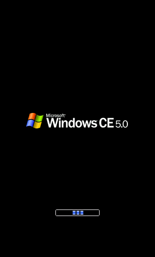
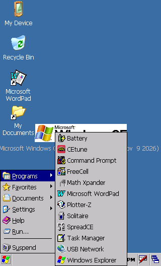
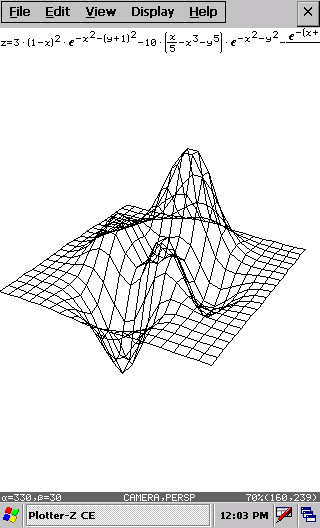
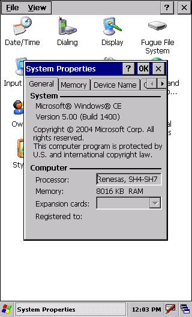
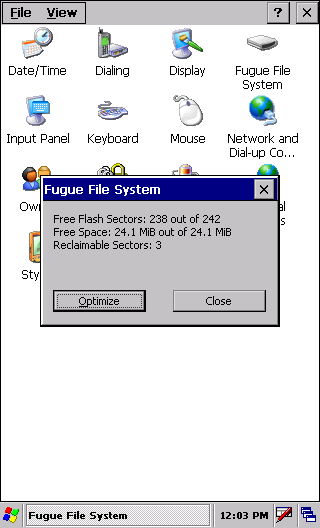
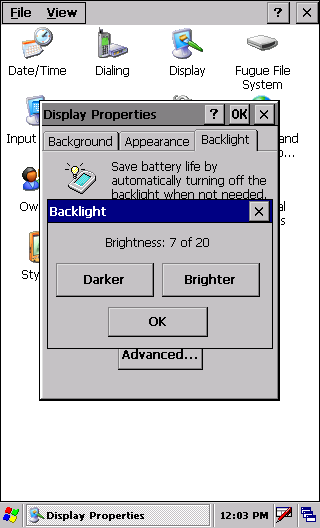

# wince-classpad

**Windows CE 5.0 ported to the Casio ClassPad II (fx-CP400 / fx-CG500)** — powered by a bare-metal same-ISA dynamic binary translator that bridges the calculator's big-endian SH7305 CPU and little-endian Windows CE binaries without replacing Casio's stock OS. 

The OS has deep integration with the calculator hardware, including the touchscreen, power management, backlight adjustment, USB, internal storage, etc.

<p align="center">
  
  
  
</p>
<p align="center">
  
  
  
</p>

---

## Story & Motivation

In the early 2000s, HP, Texas Instruments, and Casio all converged on a remarkably similar vision for the next generation of graphing calculators: a large, portrait-oriented resistive touchscreen, a stylus, and a minimalist keypad for arithmetic and navigation.

- **HP** announced the Windows CE–based **HP Xpander** (Hitachi SH-3) in 2000, only to cancel it months before mass production. HP later released its [Math Xpander](https://www.saltire.com/xpander.html) software for Pocket PCs free of charge.
- **Texas Instruments** built an entire family of touchscreen prototypes — the TI PLT SHH1, FHH1, and SU1 — running Inferno OS on TI's OMAP 1510 ARM processor, before quietly canceling the project in early 2004. (I happen to own a few TI PLT SHH1 prototypes, likely built for TI's 2002 T³ conference. They are pretty slow.)
- **Casio** was the only one to ship the concept, releasing the SH-3–based **ClassPad 300** in 2003. More than two decades later, its successors — the **ClassPad II fx-CP400** and **fx-CG500** — remain the only graphing calculators with this distinctive form factor.

The shared SuperH CPU heritage between the HP Xpander and the Casio ClassPad opened up an intriguing possibility: **bringing HP's canceled Xpander back to life on a Casio ClassPad.** With the help of Claude Fable 5.1 and 5.2, I ported Windows CE 5.0 to the ClassPad II and got the original 2001 SH-3 Math Xpander binaries running without source code or recompilation.

> *(An earlier prototype booted Windows CE 6.0 R3 all the way to the desktop, but performance was unacceptable and only a few hundred KiB of RAM remained free. Windows CE 5.0 proved to be a much better fit; the CE 6.0 BSP is kept under `bsp/classpad/` for reference.)*

---

## What Works

Target platform: **Windows CE 5.0** (`bsp/classpad50/`, Platform Builder 5.0), running in `casio-emu` and on real fx-CP400 hardware via HollyHock 3.

| Area | Status |
|---|---|
| **Loader (`wince.hh3`)** | HollyHock 3 (`gint`) add-in with a Windows XP–style UI; flashes `NK.bin` / `EXT.bin` (raw or compressed `.cez`) and launches the translator with a live boot marquee. Stock Casio OS stays intact — a reset returns straight to it. |
| **Display & Backlight** | 320×528 16-bpp RGB565 panel driver (`classpad_ddi.dll`), 0°/90°/180°/270° screen rotation, DMAC0-accelerated pushes, and a 20-step backlight applet (`Display → Backlight → Advanced...`). |
| **Input** | Resistive touchscreen (`touch.dll`) and full fx-CP400 keypad (`kbdmouse.dll`) on a shared polling tick. |
| **Storage (`\Storage`)** | Read/write access to Casio's Fugue flash volume (`\fls0`), plus a `Fugue File System` Control Panel applet with sector status and `Optimize`. |
| **USB & Networking** | SH7305 USB function driver supporting Mass Storage, CDC ACM serial, and **USB Network** (PPP over serial with a Telnet server). |
| **Power & Clocks** | Battery gauge, deep sleep/resume via SH7305 **R-standby**, and **CEtune** (an Xtune-inspired clock tuner through the OAL). |
| **Applications** | Built-in CE apps (WordPad, Explorer, Command Prompt, Solitaire, FreeCell, Task Manager), **Plotter-Z** (3D function plotter, source in tree), and Pocket PC–era SH-3 binaries (**Math Xpander**, **SpreadCE** — third-party binaries not included in git). |
| **Not Supported** | Audio / sound output. |

See [docs/08-ce50-port.md](docs/08-ce50-port.md) for detailed hardware verification logs and open items.

---

## How It Works

### The Four Hardware Constraints

1. **Wrong endianness:** Windows CE and its precompiled SH-4 binaries are **little-endian**, while Casio hardwired the ClassPad II's SH7305 CPU to **big-endian** with no software switch.
2. **No hardware FPU:** Standard Windows CE SH-4 binaries expect a hardware floating-point unit; the SH7305 has none.
3. **Only 16 MiB of RAM:** Both the OS and the compatibility layer have to live inside a tight 16 MiB footprint.
4. **Stock OS preservation:** Casio's original OS must remain intact and bootable.

### The Architecture

#### 1. Same-ISA Dynamic Binary Translation (`dbt/` + `fpuemu/`)
Because guest and host share the SuperH instruction set, most integer instructions execute directly without modification. The bare-metal translator only rewrites what differs:
- **16-bit and 32-bit loads/stores:** byte-swapped on the fly to preserve little-endian memory layout.
- **Floating-point instructions:** dispatched to a bit-accurate integer-only SH-4 FPU emulator (`fpuemu/`), with hot operations inlined.
- **Control flow & privileged state:** direct block linking, ASID-tagged lookup caches, fast TLB/exception paths, and device-aware MMIO routing for kernel/OAL code.

Pure integer arithmetic runs at near-native speed, while memory-heavy code sees roughly a 2–4× slowdown.

#### 2. Fitting into NOR Flash and 16 MiB RAM
- **Execute-in-Place (XIP) from NOR flash:** Instead of copying the OS image to RAM, Windows CE executes directly out of NOR flash. The core OS (`NK.bin`) fits into an unused 5 MiB gap inside the stock OS flash region; extra applications (`EXT.bin`) live in Casio's eActivity flash area. *(Note: booting the stock Casio OS reformats the eActivity region and wipes `EXT.bin`; `wince.hh3` can re-flash it anytime from `\fls0`.)*
- **8 MiB + 8 MiB RAM split:** 8 MiB is handed to Windows CE, and 8 MiB holds the translator runtime, block metadata, and a 4 MiB code cache.

#### 3. Running 2001 SH-3 Pocket PC Binaries (`bsp/classpad50/SRC/APPS/SH3CRT/`, `tools/`)
Running legacy binaries like **Math Xpander** and **SpreadCE** on SH-4 Windows CE 5.0 required three compatibility layers:
- **4 KiB section alignment & relocations:** Pocket PC binaries use 1 KiB alignment, whereas CE XIP requires 4 KiB (`tools/pe4k.py`, `tools/sh3prep.py`), including reconstructing missing relocation tables.
- **SH-3 floating-point shim (`sh3crt.dll`):** Bridges calling-convention differences between SH-3 CRT helpers and SH-4 system libraries.
- **Full-screen canvas patches:** Widens Math Xpander's hardcoded 240×320 canvases to the ClassPad II's 320×528 display.

---

## Repository Structure

| Path | Description |
|---|---|
| [`dbt/src/`](dbt/src/) | SH-4 decoder, code emitter, and dynamic block translator |
| [`dbt/rt/`](dbt/rt/) | Bare-metal runtime: code cache, lookup/link stubs, exception vectors, DMAC0 LCD push, R-standby, boot marquee |
| [`dbt/hhk/`](dbt/hhk/) | HollyHock 3 loader & flasher (`wince.hh3`) with `gint` UI |
| [`dbt/guest/`](dbt/guest/) | Minimal little-endian test guests (`hello`, `fpu`, `tmu`, `mmu`, `aspace`, `lcd`, …) |
| [`dbt/emu-patch/`](dbt/emu-patch/) | Patches for `casio-emu` adding ClassPad II hardware and HLE hooks |
| [`fpuemu/`](fpuemu/) | Integer-only SH-4 FPU emulator, verified bit-for-bit against host IEEE-754 |
| [`bsp/classpad50/`](bsp/classpad50/) | Active Windows CE 5.0 BSP: OAL, drivers, apps (Plotter-Z, CEtune, Control Panel applets, SH3CRT), `.bib`/`.reg` |
| [`bsp/classpad/`](bsp/classpad/) | Earlier Windows CE 6.0 R3 BSP (archived reference) |
| [`bsp/kernel/`](bsp/kernel/) | Small patches to Windows CE kernel sources |
| [`tools/`](tools/) | Image/flash utilities (`cepack.py`, `nkflash.py`, `nkbin.py`, `mkextrom.py`, `pe4k.py`, `sh3prep.py`, `stage_bsp50.py`) & debug helpers (`cesym.py`, `sh4trace.py`) |
| [`docs/`](docs/) | Design documents, measurements, and dated development logs |
| [`notes/ce/`](notes/ce/) | Notes brought back from the Platform Builder VM |

---

## Building & Running

### Prerequisites

- **macOS or Linux** with `clang`/`gcc` and `python3` (host tests and `tools/`).
- **fxSDK toolchain (`sh-elf-gcc`)** for `dbt/`, plus **`gint` (fx-CP400 target)** for `wince.hh3`:
  ```sh
  giteapc install Lephenixnoir/fxsdk Lephenixnoir/sh-elf-gcc Lephenixnoir/gint
  ```
- **Platform Builder 5.0** on Windows (a VM works well) to build `NK.bin` and `EXT.bin` from `bsp/classpad50/` — Windows CE itself is not included in this repository. See [bsp/classpad50/README.md](bsp/classpad50/README.md).
- **`casio-emu`** (optional, for emulation) patched with `dbt/emu-patch/`. `dbt/Makefile` looks in `~/Dev/casio-emu` by default (override with `EMU=...`).

### 1. Host Unit Tests

```sh
make test
```
Runs the FPU emulator, translator, and host-compilable BSP tests (timer, clock, rotation, battery, touch bus, Fugue filesystem, SH3CRT, etc.).

### 2. Building `wince.hh3` for Real fx-CP400 Hardware

Always pass **`DEVICE=1`** for real-hardware builds (disables the emulator debug port, enables the IRQ-pin guard and the boot-screen marquee):

```sh
# Build the HollyHock 3 loader + translator (verifies payload via hhkcheck)
make -C dbt DEVICE=1 BUILD=build-dev hhk

# Optional: compress NK.bin and EXT.bin (~50% smaller for faster transfer/flashing)
python3 tools/cepack.py -o dbt/build/cez /path/to/NK.bin /path/to/EXT.bin
```

Copy `dbt/build-dev/wince.hh3`, `NK.bin`, and `EXT.bin` to the calculator's storage memory (`\fls0`), launch `wince.hh3` from HollyHock 3, flash the images, and boot Windows CE.

### 3. Running in `casio-emu`

```sh
# Run a translator test guest (hello, fpu, exc, tmu, mmu, aspace, lcd, bench, ...)
make -C dbt GUEST=hello run

# Boot a Windows CE NK.bin / EXT.bin image from emulated NOR flash
make -C dbt NKBIN=/path/to/NK.bin EXTBIN=/path/to/EXT.bin RUN_SECS=300 run

# Render the loader UI screens locally on the host (dbt/build/ui-*.ppm)
make -C dbt hhk-preview
```

### 4. Staging the BSP for Platform Builder 5.0

```sh
# Copy bsp/classpad50/ with CRLF line endings into a mounted Platform Builder tree
python3 tools/stage_bsp50.py /Volumes/WINCE500/PLATFORM/CLASSPAD
```

### Debugging & Inspection Helpers

```sh
python3 tools/nkbin.py /path/to/NK.bin                       # Inspect NK.bin records & TOC
python3 tools/cesym.py /path/to/NK.bin /path/to/RelDir ADDR  # Resolve guest PC -> module!symbol
```

---

## Documentation

The `docs/` directory holds architecture references, hardware specs, and bring-up guides for the translator, OAL, and Windows CE 5.0 port:

| Document | Topic |
|---|---|
| [00-plan.md](docs/00-plan.md) | Why a translator: endianness blocker, design options, milestones |
| [01-hardware.md](docs/01-hardware.md) | SH7305 & ClassPad II hardware reference |
| [02-fpu-emulation.md](docs/02-fpu-emulation.md) | Software SH-4 FPU emulator design |
| [03-boot-and-images.md](docs/03-boot-and-images.md) | Windows CE image formats, NOR flash layout, boot paths |
| [04-dbt-design.md](docs/04-dbt-design.md) | Dynamic binary translator architecture & performance benchmarks |
| [05-ce-image-and-oal.md](docs/05-ce-image-and-oal.md) | Windows CE image configuration & SH7305 OAL |
| [06-deep-suspend.md](docs/06-deep-suspend.md) | SH7305 R-standby deep suspend & resume |
| [07-ce42-port-lessons.md](docs/07-ce42-port-lessons.md) | Lessons from the CE 6.0 port applied to CE 5.0 |
| [08-ce50-port.md](docs/08-ce50-port.md) | Windows CE 5.0 port log, device Bring-up & hardware feedback |
| [09-platform-builder-steps.md](docs/09-platform-builder-steps.md) | Platform Builder VM setup notes |
| [design/loader-luna.html](docs/design/loader-luna.html) | Interactive mockup of the `wince.hh3` loader UI |

---

## Third-Party Material

Third-party components included or derived in this repository (Microsoft runtime DLLs and artwork, Plotter-Z, bitmap fonts) are credited with their origins in [THIRD-PARTY.md](THIRD-PARTY.md).
